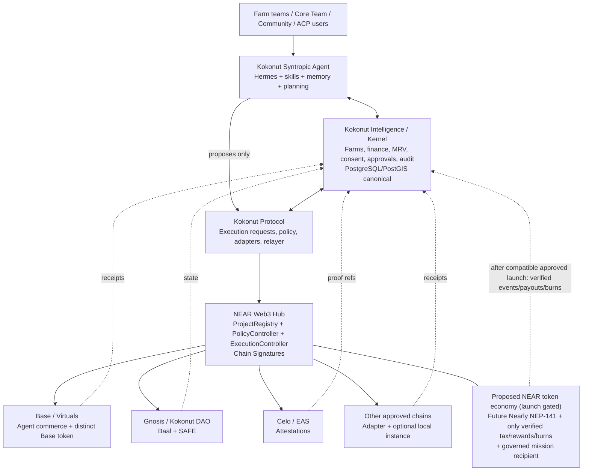
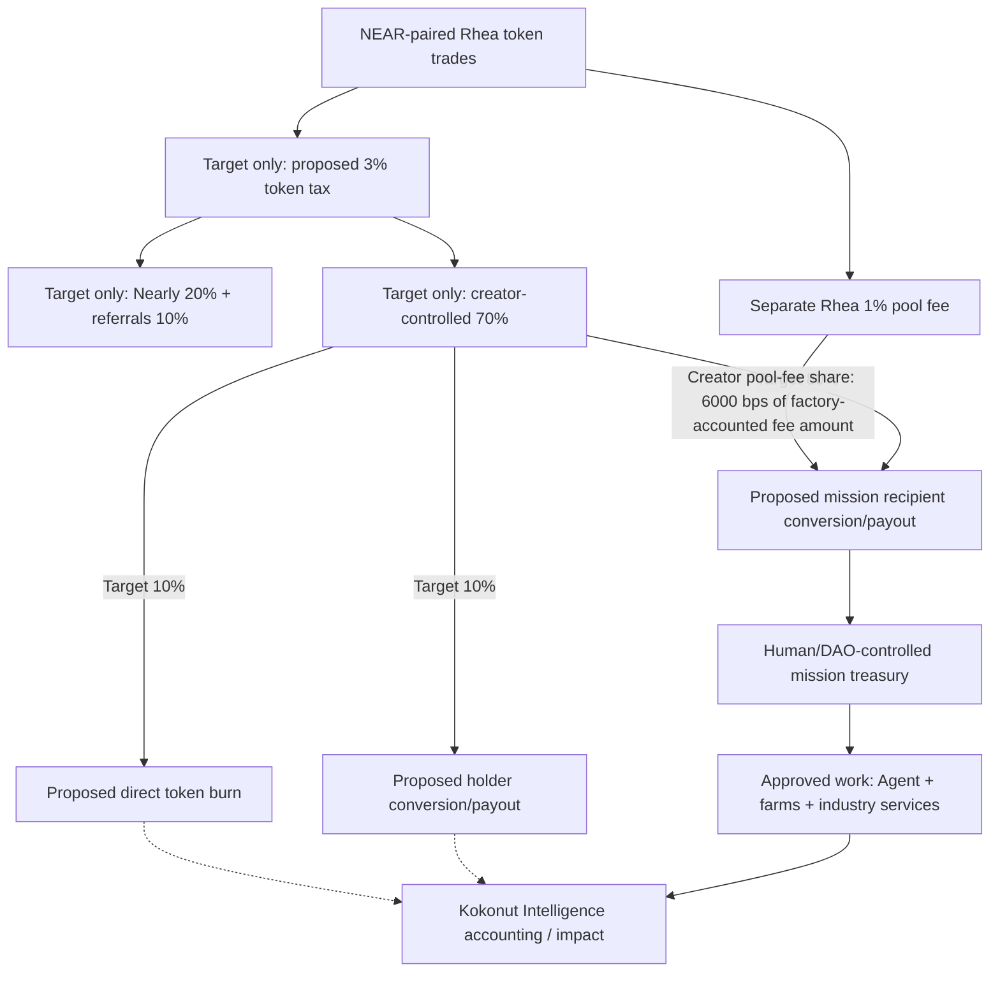

# Description

-----------------------------

# Kokonut Syntropic Agent — NEAR Universal Orchestrator, Native Economy & Multichain Growth PRD

**Version:** 1.1 — Nearly-native launch and automated reward amendment (proposed for approval)<br>**Date:** 2026-10-21 (revision of v1.0)<br>**Product:** Kokonut Syntropic Agent / NEAR Hub Instance<br>**Parent specifications:** `Kokonut Protocol — Research-Backed Implementation PRD` (attached reference; implementation-ready architecture) and `Kokonut Syntropic Agent — Virtuals Token Launch & Capital Formation Master PRD v1.1` (existing commercial/launch baseline)<br>**Operating organization:** Kokonut Network ecosystem; Wasalo Tech, SRL dba Kokonut Onchain Network is the previously designated Virtuals/Base launch operator. **NEAR token issuer and legal fee obligor must be approved separately.**<br>**Status:** revised design and engineering acceptance requirements; user-selected Nearly mechanics. **Not** a token sale authorization, smart-contract audit, legal opinion, investment offering, or deployed product.<br>**Supersedes:** `Kokonut_Syntropic_Agent_NEAR_Universal_Orchestrator_PRD_v1_0.md`Does **not** supersede Kokonut Protocol PRD or Virtuals/Base Master PRD.<br>**Change authority:** Kokonut Core Team product decision: Nearly is the selected launch surface; the 3% buy/sell tax and 80% creator / 10% holders / 10% burn settings are a target. The outer 70/20/10 allocation is target-only and launch is blocked pending compatible contract support, final-term verification, and human/legal approval.[1][2]

---

**Contract-state amendment (2026-10-24):** Use deployed contract state over stale documentation for the separate pool-fee `creator_share_bps`: the factory reports **6,000 bps**, not 7,000. The latest live read-only readiness snapshot at finalized block 221417620 returned `[400, true, 4000]` for `get_tax_bounds`; source constants compose the 4,000-bps platform amount from protocol, platform-level holders, and referral pots. The PRD's 70/20/10 gross token-tax allocation nests holders within the creator share and remains a **target only**, not current contract behavior. **Launch is blocked** until deployed code and final terms support that target and required human/legal approvals are recorded. The 6,000-bps pool-fee setting does not establish token-tax support.[1][2]

## 0. Executive decision and product thesis

**Decision recommended:** Build **one canonical Syntropic Agent** with multiple **chain-qualified instances**. Use **NEAR as the Kokonut Protocol Web3 Hub and the agent's orchestration anchor**, preserving the **Virtuals/Base instance and Base-native token as a distinct pre-existing commercial and capital formation surface**. The **target** is a distinct NEAR-native token through Nearly with 3% buy/sell tax, a 70/20/10 gross tax split, and an 80/10/10 creator-side allocation. These are **not verified as supported by the current factory state; launch is blocked** pending compatible contract support, final-term verification, and human/legal approval.[1][2] This is not a 20% distribution of ordinary creator pool fees. Allow additional chain-native tokens only when chain-level user demand, fee ownership, economic viability, security and legal authority pass a repeatable test.

The agent is not omnipotent: it is **universally addressable within deployed, tested adapters**, constrained by authorization, data consent, chain support, runtime availability, destination gas, settlement finality, and human governance. “A presence on every chain” means **presence and usable capability where authorized**, not deploying an investment token on every chain.

The economic thesis is **work -> evidence -> useful coordination -> earned revenue -> accountable mission funding -> more real-world productive capacity -> more useful work**. Trading activity is a potential fee source, not proof of agricultural impact or of operating profitability.

### 0.1 One-sentence positioning

> **The first AI orchestrator of Kokonut Protocol: a NEAR-anchored, chain-agnostic coordination agent that turns authorized intelligence and ecosystem services into measurable real-world regenerative flywheels.**

### 0.2 Success, not speculation

Success means independently verified outcomes: improved Adelphi and Terra Viva operations, additional partners/farms, real paid work, durable contract security, accurate revenue reconciliation, and explicit community participation. If a compatible, approved Nearly launch occurs, a distinct NEAR token could add community utility and contract-defined holder rewards or burns; until then these are targets, not live features. Neither token ownership nor any future reward would imply title to farmland, existing DAO assets, protected reserves, or the Base token's revenue.

### 0.3 Non-negotiable inherited rule

From the attached approved Protocol PRD:

> **Kokonut Intelligence owns truth. Kokonut Protocol owns cross-chain policy and execution. NEAR owns the interoperability/signing hub. Destination chains own local settlement and enforce local rights.**

Kokonut Intelligence retains canonical operations, evidence, accounting, identity attribution, permissions, human approvals and reporting. Do not duplicate or supersede the Protocol hub, adapters, relayer, nonce manager, Revenue Container ledger, EAS federation, or Gnosis/Baal governance.

---

## 1. Source hierarchy, verified capabilities, and unresolved inputs

| Category | Grounded source or decision | How it constrains this PRD |
| --- | --- | --- |
| Protocol architecture | Attached `Kokonut Protocol — Research-Backed Implementation PRD`, sections on authority, NEAR Hub, execution, data, nonce safety, revenue, audit | **Binding architectural baseline**, no parallel signing control plane |
| Organizational mission | <https://kokonut.network/llms.txt> and linked Kokonut Framework / Adelphi / AI documentation | Local stewardship, multiple forms of capital, material outcomes and accountable MRV |
| Current KI code | <https://github.com/wasalo/Kokonut-Intelligence/tree/feat/mobile-offline-acceptance> | Existing draft synthesis and agent safety; branch is active/candidate rather than assumed deployed |
| Agent runtime | <https://hermes-agent.nousresearch.com/docs> | Hermes is the AI runtime, learning/skills/memory/tool orchestration, not a governance signatory |
| Base commercial launch | Prior user-approved Master PRD v1.1 | Virtuals economy is retained; **no duplicate cross-chain economic claims** |
| NEAR chain abstraction | <https://docs.near.org/chain-abstraction/what-is> and /chain-signatures | Signatures sign; Kokonut constructs, broadcasts, verifies and reconciles |
| Asset settlement | <https://docs.near-intents.org/index> | Intents is an **optional** asset-routing adapter, not core authorization |
| NEAR token standards | NEP-141: <https://github.com/near/NEPs/blob/master/neps/nep-0141.md> | Fungible token balances, callbacks and storage require NEAR-specific handling |
| Treasury/governance | <https://github.com/NEAR-DevHub/trezu-docs> and <https://github.com/near-daos/sputnik-dao-contract> | Scoped DAO/member approvals; confirm deployed contracts, admin/factory power and upgrade controls |
| **Selected NEAR launchpad (launch gated)** | <https://nearly.trade/docs> ; <https://nearly.trade/launch> ; Rhea <https://guide.rhea.finance> | Proposed tax settings are immutable at launch; current factory tax bounds mismatch the 70/20/10 target. Verify support, final terms, and approval first.[1][2] |
| Optional private compute | <https://docs.near.ai> ; <https://app.outlayer.ai/docs/getting-started> | Optional later; TEE attestation != authorization or independently verified farm evidence |

**Known engineering gap:** The KI `docs/agent-safety.md` and `docs/refactor/agent-ecosystem-kernel-contract.md` acknowledge that database-level least privilege for agent identities and identity attribution for legacy/background agent writers remain incomplete. The newer authenticated location-scoped AI-summary slice is more narrowly scoped. This PRD **does not assert that a general-purpose production financial agent authorization pathway already exists**. Use separate audited operator/Protocol services and fail-closed permissions.

**Source limitations:** Promotional product pages and launchpad self-descriptions are not security audits. Nearly’s documentation describes a high-level tax configuration, but the pinned factory bounds currently mismatch this PRD's 70/20/10 target; the target remains blocked pending compatible code, final-term verification, and approval.[1][2] Exact deployed version, postlaunch immutability, wallet routing, redemption/burn behavior, fees and any documentation/UI divergence **must be verified against the actual on-chain deployment and final signed launch transaction**. GoMining is studied only as a token utility/lock-and-vote design comparator; mining mechanics are not assumed relevant to agriculture.

---

## 2. Relationship to existing Kokonut Protocol and Virtuals specifications

| Element | Kokonut Intelligence | Kokonut Protocol / NEAR Hub | Syntropic Agent | Local chain ecosystem |
| --- | --- | --- | --- | --- |
| Real-world farm records | Canonical writer/reviewer | Hashes/references and policy input | Authorized analysis, draft and coordination | No independent canonical copy |
| User approval | Authenticated human/DAO decision record | Enforces approved commitment | Requests, never self-approves | Enforces local contract rights |
| Chain execution | Execution ledger/events | Policy, signer requests, adapters, relayer/reconciliation | Plans/compiles intents to proposed action | Finalizes local state |
| Revenue and rights | Canonical accounting/entitlements | Container/settlement abstraction | Monitors and proposes | Token/treasury owns specific native rights |
| Base token | Commercial reference and financial ledger only | Optional Base adapter | Same canonical agent, Base-facing instance | Virtuals controls its actual token launch semantics |
| NEAR token | If launched, canonical accounting of verified Nearly tax/pool events, treasury receipts and reward/burn totals | NEAR Hub identity, approved action path | Same canonical agent, NEAR-facing instance | **Target:** Nearly-provisioned NEP-141 token + built-in tax rewards/burns; launch blocked until contract support and approval are verified |
| Gnosis DAO | Governance evidence/indexing | Baal/Safe adapter | Propose/research only | Existing governance and Ragequit preserved |
| Celo EAS | Canonical claim and evidence lineage | Federation adapter | Prepare attestation request only | Existing EAS deployment preserved |

**Not a Protocol amendment:** This PRD adds Syntropic-specific orchestration and economics **using** the Protocol contracts. Any material change to the parent Protocol's signature, role, data or ledger interfaces requires an explicit ADR, review and parent-PRD change control.

**Not a Base token migration:** The existing Virtuals token and any future NEAR token would be **separate token contracts with separate disclosures, holders, revenue rights and supply schedules** if the Nearly launch gate is met. Neither is a bridge representation of the other. Cross-chain interoperability of the **agent** is not fungibility of the **tokens**.

---

## 3. The agent's universal identity and chain instance model

### 3.1 Canonical identity

Create an off-chain canonical `agent_id` (UUID, existing KI agent identity as appropriate) plus a versioned public `AgentManifest` with a reproducible content hash. NEAR `AgentRegistry` may anchor a minimal agent ID/manifest hash/status and authorized chain instance hashes. Public identity is **not** secret key custody.

Conceptual `AgentManifest` fields:

```json
{
  "schema_version": "1.0",
  "agent_id": "<canonical-uuid>",
  "display_name": "Kokonut Syntropic Agent",
  "runtime": "Hermes",
  "operator_entity_ref": "<approved entity registry reference>",
  "ki_agent_identity_ref": "<KI record UUID>",
  "near_hub_contract": "<approved NEAR account ID>",
  "policy_hash": "sha256:<approved policy hash>",
  "capability_manifest_hash": "sha256:<capabilities hash>",
  "chain_instances": [
    {"namespace":"eip155","chain_id":"8453","instance_ref":"virtuals-base","token_ref":"<Base token contract>","role":"commerce"},
    {"namespace":"near","chain_id":"mainnet","instance_ref":"near-hub","token_ref":"<NEP-141 account>","role":"orchestration"}
  ],
  "status": "active"
}
```

**Implementation:** Chain identifiers are strings and always chain-qualified; concrete values/addresses remain placeholders until independently verified. Hash the canonical encoding, pin an immutable signed copy, and record effective dates. DID, ENS, ERC-8004 and NEAR account names are optional identity *claims*, not identity itself. Provide cross-chain challenge proofs for wallet bindings.

### 3.2 One agent / many instances

An instance consists of `(agent_id, chain_namespace, chain_id, deployment_profile_id, role, controlled_accounts, capabilities, token_ref?, fee_policy_ref?, status)`. The agent runtime can serve many instances; an instance never automatically inherits permissions/treasury assets from another. A chain without economic viability still receives a **utility-only** instance (read/route/attest/propose where supported) with **no new token**.

### 3.3 Relationship and permissions

1. The Core Team delegates bounded work, not unlimited agency.
2. Hermes produces signed/auditable proposals referencing exact KI evidence and Protocol actions.
3. The KI/Protocol authorizer checks allowed actors, project scope, limits, immutable action hash, and approval state.
4. The NEAR Hub checks caller, operation, chain, project, hash, replay guard, expiry, value, and emergency pause.
5. Destination local contracts independently enforce restrictions.
6. Indexers verify destination effects and reconcile into KI.
7. If any layer rejects or cannot verify, the operation remains pending/rejected/manual review; **never infer success from an LLM answer or signature**.

### 3.4 Credential classes

* **Hermes runtime token:** cannot spend protected funds, cannot invoke financial approval methods.
* **NEAR function-call key:** restricted methods, receiver and allowance where supported; never a full-access key in the agent runtime.
* **OutLayer optional wallet/API:** separate sandbox, distinct from Protocol NEAR Hub authority; audit its trust assumptions and any gateway substitution exposure.
* **Treasury signer:** independent human/DAO quorum, never an agent-held credential.
* **Relayer:** destination broadcast only for payloads with an immutable reviewed commitment.

---

## 4. System architecture



**Important:** The NEAR Hub orchestrates **authorization/signing** of chain-specific actions; a chain adapter/relayer still builds and broadcasts destination transactions, monitors finality, verifies effects and reconciles. NEAR Intents separately routes **assets**, not arbitrary contract execution. Do not describe Chain Signatures as atomic cross-chain execution, free destination gas, cross-chain proof of off-chain events, or unconditional access to every chain.

### 4.1 Modules owned by the Syntropic Agent project

* `AgentOrchestrator`: plan decomposition, scheduling, priority, resource constraints.
* `CapabilityBroker`: versioned skills and per-chain adapter feature discovery.
* `FarmMissionPlanner`: evidence-backed interventions and work package proposals.
* `AgentCommerceConnector`: preserve Virtuals ACP jobs; third-party clients optional.
* `ChainInstanceRegistryClient`: query token/permission/contract registries.
* `NearlyEconomicsObserver`: after any compatible, approved launch, read-only Nearly tax/pool-fee events, actual creator receipts, native holder reward totals, direct burns and anomalies.
* `TokenomicsPreview`: read-only explanation of product targets before launch and verified immutable terms after launch; **no distribution ledger, claims engine or payout signing**.
* `ImpactEvidenceCompiler`: generate public claim drafts with provenance and review status.
* `GovernanceAssistant`: prepare NEAR DAO, Gnosis, and project-specific proposals for authorized humans.
* `OperationsConsole`: chain-local overview, queue, costs, risk, human approval and rollback.

### 4.2 Interfaces, not a shadow platform

The agent may **consume** KI task catalogue, service APIs, evidence, read-only DAO/attestation adapters, and Protocol execution-request schema. It must not maintain parallel farm truth, independent transaction state machines, second escrow accounting, shadow governance, or a second EVM nonce allocator.

---

## 5. NEAR ecosystem primitives mapped to agent capabilities

| Primitive | Suitable role | Status / guardrail |
| --- | --- | --- |
| NEAR native accounts + subaccounts | Identity and isolated service accounts | Prefer governed names; contract addresses must be verified |
| Function-call keys | Least-privilege non-financial agent calls | Contract/method scope + allowance; no full-access agent key |
| Meta-transactions (NEP-366) | Sponsored low-risk onboarding and calls | Sponsor budget caps, anti-bot and replay checks |
| Chain Signatures | NEAR hub requests signatures for approved external chain actions | Existing Kokonut Protocol execution policy and relayer ONLY |
| NEAR Intents / 1Click | Optional cross-chain settlement and swaps | Mainnet sandbox with small values, slippage/refund and failure paths; not P0 |
| NEP-141 fungible token | NEAR economic participation token | Token standard is not a fee-sharing feature by itself |
| Rhea DEX | NEAR-native liquidity/pool and fee source | Platform-specific fee shares and fee-asset accounting |
| **Nearly (selected, launch gated)** | Proposed fixed-supply NEP-141 launch + Rhea DCL pool + proposed native buy/sell tax, holder rewards, token burns and creator fee flows | The 70/20/10 external tax split is a target only; current factory bounds mismatch it. Verify supported tax terms and approval before any launch.[1][2] |
| Trezu / SputnikDAO | Mission treasury and proposal-controlled spending | Confirm DAO factory roles, quorum, update keys and timelocks |
| NEAR AI Cloud | Optional confidential inference | Confidential compute doesn't grant transaction authorization |
| OutLayer | Optional TEE compute / agent wallet experiments | Vendor-dependent custody and policy; no replacement for Hub controls |
| Aurora | EVM compatibility option on NEAR ecosystem | Separate EVM adapter and deployment/fee economics review |
| GoMining tokenomic references | Locking, utility, voting analogies | Not a proposed dependency or evidence of fit |

---

## 6. Proposed NEAR-native token and Nearly economics (launch gated)

### 6.1 Token role and explicit rights

The target is a **distinct NEP-141 instrument** associated with the same canonical agent identity as its Base/Virtuals presence. Only if a compatible, approved launch occurs could it provide NEAR service discovery, governance signaling on authorized NEAR matters, community education, or automatic holder rewards under verified Nearly rules; the proposed token is not live. **No automatic right** exists to Wasalo Tech equity, leased land, Adelphi/Terra Viva assets, Gnosis DAO treasury/Ragequit, farm Revenue Containers, Base/Virtuals token fees, or cross-chain token redemption. Legal review determines how any built-in holder payouts may be described and offered.

**Selected issuance (launch gated):** Nearly, paired with **NEAR** on Rhea DCL, subject to final due diligence and compatible contract support. Nearly documents a **fixed 1,000,000,000 token genesis supply**, 18 decimals, one-time mint into a locked launch liquidity position, no further mint method, and a 1% Rhea DCL pool-fee tier. There is **no bonding-curve graduation** and **no default team-token grant**; any developer token exposure requires normal on-market acquisition under applicable rules and disclosures. Token name/ticker remain unreserved and unverified until actual launch.

### 6.2 Proposed target economics; launch gated

The product **target** is **3% on buys and 3% on sells**, with an outer 70/20/10 gross tax split and a proposed 80/10/10 allocation within the 70% creator-controlled share. Current factory bounds do not support that outer target; **launch is blocked** pending compatible contract support, final-term verification, and approval.[1][2] In the described Nearly schema, `creator_bps`, `holders_bps`, and `burn_bps` divide the creator-controlled share. The following are target parameters (basis points), not an approved or ready-to-submit launch payload:

```json
{
  "buy_bps": 300,
  "sell_bps": 300,
  "creator_bps": 8000,
  "holders_bps": 1000,
  "burn_bps": 1000
}
```

The authoritative factory `launch` call accepts this nested `tax` object alongside `creator_share_bps` (currently **6000** for the separate pool-fee share), token metadata, selected pair, and any first buy.[1][2] The launch form must display matching terms before signature. An **illustrative target-validation fragment**, not a ready-to-send transaction or evidence of current tax support, is:

```json
{
  "creator_share_bps": 6000,
  "tax": {
    "buy_bps": 300,
    "sell_bps": 300,
    "creator_bps": 8000,
    "holders_bps": 1000,
    "burn_bps": 1000
  }
}
```

**Factory and immutability constraints:** Nearly documentation identifies `nearlytrade.near` as the launch factory, `dclv2.ref-labs.near` as the Rhea DCL exchange, and `feeswap.near` as the tax-selling service. `creator_share_bps` is a pool-fee setting and currently reads 6000; it is not a token-tax share.[2] The target 70/20/10 tax split is blocked because the pinned factory tax bound reports 4000 platform bps, not the target 3000.[1][2] **Tax rates and tax split cannot be changed after creation**. Complete exact on-chain contract verification, corporate/legal approval and a dry-run checklist *before* signing. A bound compatible with the target is necessary, not sufficient; verify the exact deployed code and final payload.

### 6.3 Tax target and separate pool-fee stream

**Stream A — proposed 3% token transfer-tax target; launch blocked.** If a future compatible contract and approved launch support it, the intended tax is collected in the launched token for qualifying Rhea exchange buys and sells. The target allocation is:

* **Target only — 70% creator-controlled portion:** proposed subdivision **80% to Kokonut mission recipient; 10% automatically to eligible holders; 10% directly burned**.
* **Target only — 20% Nearly protocol**.
* **Target only — 10% referral pot**.

Under this **target only**, the proposed gross-tax model is `56% mission + 7% holders + 7% direct burn + 20% Nearly + 10% referral`. These are portions of the **taxed token quantity**, *not guaranteed equivalent US dollars from a trade*. Do not represent this allocation, conversion, holder payout, or burn as current factory behavior; launch remains blocked until contract support and approval are verified. Any future mission/holder conversion and payout behavior must be verified from the deployed contract and receipts.

**Stream B — separate Rhea DCL pool fee.** The factory's observed `creator_share_bps=6000` is the creator's share of the factory-accounted pool-fee amount, not a 7,000-bps share and not a token-tax setting.[1][2] Do not claim a 0.56%-of-trade-input entitlement from the current factory setting; the absolute trade-input equivalent requires separate verified DCL/locker mechanics. The Kokonut target allocates any verified creator pool-fee receipts to the **mission treasury only**, subject to custody/accounting and legal approval; it does **not** distribute 10% of these pool fees to holders or burn 10% of them. Clearly identify each stream on the public dashboard.

**Important routing exception:** On tax-enabled tokens, adding/removing Rhea liquidity and claiming pool fees can also trigger tax when the token crosses the DCL exchange boundary. Wallet-to-wallet transfers are **not taxed**. When presented to traders, a 3% tax plus 1% pool fee is a **fee-layer description**, not a promise of exactly 4% USD execution cost; prices, routing, fee assessment order and slippage matter. Avoid claiming “80% of all trading fees go to Kokonut.”

### 6.4 Unit-testable worked example — taxed token amount, not profit

Hypothetical **target-only** example: taxable token amount **10,000 units**; a proposed 3% rate removes **300 units**. The following is not current contract behavior and cannot authorize a launch:

| Destination | Tokens / units of tax | Formula |
| --- | --- | --- |
| Creator-controlled portion | 210 | `300 × 70%` |
| — Mission portion (to be converted to NEAR by Nearly) | **168** | `210 × 80%` |
| — Holder portion (to be converted to NEAR by Nearly) | **21** | `210 × 10%` |
| — Direct burn | **21** | `210 × 10%` |
| Nearly protocol | 60 | `300 × 20%` |
| Referrals | 30 | `300 × 10%` |
| **Total collected token tax** | **300** | `168 + 21 + 21 + 60 + 30` |

Creator/holder token amounts are **pre-conversion quantities**, not promises of NEAR or USD proceeds. Market pricing, liquidity, conversion batches, sell pressure, failed swaps and payout thresholds affect realized proceeds. A zero-trade period creates no new trade-tax allocations. Rhea creator pool fees are computed **separately** and must never be added to these percentages without common-asset conversion and accurate ledger treatment.

### 6.5 Operational money and event flow — no Kokonut distribution vault



**No custom** `SyntropicFeeCollector`, `SyntropicFeeSplitter`, `SyntropicHolderDistributor`, Merkle-based claim vault, snapshot producer, paid claim service or payout signer is in scope. Only after compatible contract support and launch approval are verified would Nearly handle any configured tax collection, splits, burns, holder eligibility and reward delivery. Until then these are target functions, not active Kokonut revenue or rewards. Kokonut builds only a **read-only monitor/indexer plus normal treasury accounting**, not another holder-custody obligation. The **mission revenue beneficiary is still an actual NEAR account** with governance/corporate controls; verify creator fee routing before any launch. Do not assume Nearly supports changing the creator/mission recipient after launch, and do not turn a Hermes-held wallet into a treasury owner.

### 6.6 Holder rewards — native Nearly rules, not custom claims

For a compatible future launch, Nearly documentation describes proportional automatic holder payouts in the pair asset (with NEAR pair, **NEAR**) based on token balances, approximately **every 15 minutes once at least $0.10 equivalent is owed**. Small balances remain due until threshold; exchange-held tokens (including Rhea LP positions) do not qualify. These are documented platform rules, may change, and require inspection of deployed code; they are not currently available to this proposed launch absent verified contract support and approval. Kokonut does not define independent snapshot epochs, proof roots, manual claims, or any second promise of entitlement.

After a compatible, approved launch, the agent may expose a safe, read-only “Rewards & Supply” interface showing the token account, actual immutable rates and weights, rewards paid/pending where publicly observable, fees actually received, direct burns, and exclusions known from the Nearly contract. Before that gate, display the 3% / 70/20/10 / 80/10/10 settings only as **targets**, not live terms. Holders interact with **Nearly or wallets**, not Kokonut's own reward vault. The displayed legal rights must match the actual immutable launched token.

### 6.7 Fee source and bookkeeping

If a compatible, approved launch occurs, maintain separate **observational** records for: token-tax assessment; external protocol/referral allocation; mission-side tax conversions/payouts; native holder payouts; direct burns; creator Rhea pool fees; treasury receipts; later governed expenditure. Use NEAR-account-qualified contract IDs, transaction/receipt IDs and event indices. Do not treat observed volume as revenue, owed amounts as cash in hand, Rhea fees as taxed-token proceeds, or burned supply as spendable assets. NEP-141 values remain exact integers with decimals recorded; NEAR amounts use yoctoNEAR; mark multi-asset receipts with asset IDs.

**Receipt states:** `observed → externally_processed → finalized → reconciled`, with `failed`, `unknown`, `reorg/rollback`, or `manual_review` branches if chain/indexer behavior requires it. The external platform, not Kokonut, is responsible for payments and claims. KI should be able to **reproduce observed distribution totals** from the platform, not be required to independently execute distributions.

### 6.8 Nearly integration invariants / release tests

* **N1 configuration:** Proposed target only: `buy_bps=300`, `sell_bps=300`, `creator_bps=8000`, `holders_bps=1000`, `burn_bps=1000`, with creator-side weights totaling `10000`; factory must support the target platform share and exact final terms before launch. Current factory bounds do not; launch is blocked.[1][2]
* **N2 immutable on-chain terms:** After compatible, approved deployment, verify one 1B/18-decimal mint, launch pool identity, liquidity lock, unavailable tax-change/extra-mint methods, and exact deployed account/code hash before treating any terms as live.
* **N3 split conservation:** After a compatible contract is independently verified and approved, each reconciled tax batch must match the approved target amounts sent/processed to platform, referrals, mission, holders and burn, allowing documented integer dust and asynchronous pending balances. The target is gross tax `70/20/10` and creator-controlled `80/10/10`; this is not current behavior and launch is blocked until support is proven. No unsupported “all fees” claims.
* **N4 holder payout correctness:** After compatible, approved launch, user-facing reward figures match Nearly on-chain/native state; Kokonut never promises or manually pays claims from its funds; no fictitious payouts below thresholds.
* **N5 real burn:** After compatible, approved launch, burn evidence matches actual supply decrease and chain events, not a treasury wallet or simulated buyback. Report burnt units and percent of original genesis supply accurately.
* **N6 mission receipts:** Net NEAR/token amounts actually received by the designated beneficiary reconcile to company/DAO accounting with legal entity, project classification, custody and chain-qualified source.
* **N7 separate pool fees:** Rhea creator pool-fee amounts are attributed separately and cannot be reprocessed through token-tax percentages.
* **N8 authorization:** Agent cannot launch tokens, configure tax, change fee recipients, claim treasury fees or authorize financial spending. Humans/authorized DAO sign restricted actions.
* **N9 price/manipulation:** Failed conversions, routing, slippage, volume manipulation, DCL liquidity changes and accounting anomalies are observable and trigger warnings/manual review.
* **N10 economic isolation:** No fee-sharing implied between NEAR and Virtuals Base token, Gnosis DAO, farm Revenue Containers or land rights.
* **N11 legal:** Native automated payouts do not remove issuer/marketer’s legal obligations; independent review before irreversible token deployment.
* **N12 limits:** Platform rate/contract changes trigger version revalidation. If the exact settings cannot be demonstrated on the signed launch payload and factory state, **do not launch**.

### 6.9 Mission treasury policy and use of collected growth funds

**The target 80% mission share** means 80% **of the proposed creator-controlled tax allocation**, not 80% of the entire tax or DCL fees. The target is not supported by the current pinned factory bounds; launch remains blocked pending compatible contract support and approval.[1][2] Separately, only verified creator pool-fee receipts may be routed to the mission under an approved policy. The mission recipient must be legally authorized and human/DAO-controlled, never an unrestricted Hermes wallet. Its expenditure taxonomy is **farm productive capacity** (Adelphi priority, Terra Viva when ready), **agent infrastructure** (model/compute/security/operations), **agricultural industry services**, **open-source/builder contributions**, and **reserves**. The exact budget percentages require an approved budget and source-of-funds restrictions—not Pareto branding.

Wasalo Tech, SRL holds lease rights for Adelphi and Terra Viva per user-confirmed context; funding must respect those agreements, corporate approvals and taxes. If a NEAR token is ever issued, holders would receive no direct title, lease, dividends from farm operations, DAO membership, or project redemption rights by default. Determine any future NEAR token issuer, fee recipient and beneficiary independently of the Virtuals/Base arrangement.

### 6.10 Legal, economic and trader-risk release gate

A token with **automatic pro-rata NEAR payouts conditioned on holding**, including through a third-party launchpad, may raise securities/collective investment, consumer, tax, AML, marketing and cross-border questions. Nearly executing the distribution mechanically does **not** determine the legal characterization or eliminate the entity’s responsibilities. Require formal legal signoff before mint/launch and before promoting “rewards,” “profit sharing,” or “fee yield.” The buy/sell tax is irrevocable and adds to trading costs; disclose front-running/slippage, thin opening liquidity, price impact, potential fee-swap sell pressure, fee fluctuation, token risk, vendor/contract risks, and lack of guaranteed return. No spendable capital is assumed from market cap/TVL or unreceived fees.

---

## 7. Selected NEAR launch platform: Nearly + Rhea

**Decision:** Nearly is selected over Shards, Meme.Cooking and a custom token/claim infrastructure, but this does not authorize a token launch. Rhea DCL is the selected launch-pool surface. The intended Nearly token tax, protocol-side processing, holder payouts, and burns remain target features until the deployed factory supports the approved terms; the current tax bounds mismatch the target and launch is blocked.[1][2] The alternate platforms are **historical due-diligence comparators**, not implementation dependencies.

| Requirement | Selected approach | Evidence / remaining gate |
| --- | --- | --- |
| Token launch | Proposed future Nearly fixed-supply NEP-141 token; no Kokonut NEAR token is live | Verify current factory and actual token account/state only after compatible support and approved launch |
| Pair / liquidity | NEAR pair through Rhea DCL 1% tier | Validate pool ID, launch lock contract and actual initial liquidity |
| Buy / sell tax | **Target only:** 3% both directions (`300` bps) | Current support/approval not established; launch blocked until verified |
| Creator tax allocation | **Target only:** `80% mission / 10% holders / 10% burn` of the proposed 70% creator-controlled portion | Current factory tax bounds mismatch the target; contract support, final payload, and approvals are launch blockers.[1][2] |
| Holder rewards | **Target:** Nearly-native automated NEAR payout after compatible support/approval | Verify pair asset, eligibility, payout thresholds and event read APIs before launch |
| Token burn | **Target:** Nearly-native direct burn of collected tokens after compatible support/approval | Verify supply decrease/event and distinguish from buyback before launch |
| Creator pool fee | Observed `creator_share_bps=6000` share of factory-accounted fees, separate from tax | Verify actual fee source, amount, asset and permitted treasury destination; do not infer a trade-input equivalent.[1][2] |
| Treasury | Existing/new authorized NEAR account under legal and human/DAO controls | Verify fee-routing semantics; **not** a new dividend vault |
| Audit and legal | Published code/contract identifiers, independent scope review and local advice | Launch blocker until completed |

**Documented contracts (reverify on-chain before launch):** `nearlytrade.near` factory; `dclv2.ref-labs.near` Rhea DCL; `lock.nearlytrade.near` for launches 0–157 and `lock2.nearlytrade.near` for later launch IDs; `feeswap.near` for current fee-tax conversion. Confirm the launched token account via factory `launch` event and `get_locker_for(launch_id)`, not symbol alone (tickers are not globally unique). NEAR quote pair uses `wrap.near`.

**Test approach:** Nearly documents its contracts as **mainnet** infrastructure. Use local fork/mock/integration fixtures for economics and failure simulation, and only **small, explicitly approved mainnet calls after legal/security gates**. Do not promise access to a Nearly testnet, mutable tax rates, unlocked LP, discretionary token mint, or free first buy. Nearly documents that `quote_launch` determines attached deposit, and wallet registration and gas are separate operating considerations.

**No custom distribution contract.** The benefit is fewer trust/custody surfaces, fewer callbacks to implement and no holder payout liability managed through a Kokonut vault. Remaining risks are **platform dependency, irrevocable launch parameters, recipient-key security, vendor execution timing, taxed liquidity operations, token-tax accounting, and regulatory treatment**. Verify creator destination capability *before* signing: a launcher/creator wallet may receive mandatory payouts and may not be editable later. If direct payout to the controlled treasury cannot be configured, obtain a separately reviewed custody/control solution and disclose it; do not silently create a distributor vault.

**Sourcing:** <https://nearly.trade/docs> (Overview, Creator Fees, Tax, Launching from a Contract or Script, Contracts, Safety Model); <https://nearly.trade/launch>; <https://guide.rhea.finance/>. Verify live contracts and user interface at launch time.

---

## 8. NEAR-native governance and control

### 8.1 Governance layers

* **Core Team / approved legal operator:** responsible for legal compliance, contracts, farm obligations, fiscal custody and authorization policies.
* **NEAR Mission Treasury (Trezu/SputnikDAO-compatible):** transparent NEAR-local funds, proposal approvals, expenses, grants, verified receipt accounting and **Kokonut-controlled treasury spending pauses**. It cannot pause/change Nearly’s immutable tax or native holder distributions.
* **Potential NEAR tokenholder forum / voting layer, only if launched:** bounded participation in agent service priorities, open-source roadmap, nonbinding recommendation signals, and any legally and contractually granted economic-policy votes.
* **Kokonut Protocol NEAR Hub:** enforces operation and chain policies, with its **own** signer quorum and replay controls; must not silently inherit tokenholder governance outcomes as executable authority.
* **Kokonut Gnosis DAO:** continues to govern its own Baal/Safe rights and protected treasury without NEAR token voting power or cross-Ragequit.
* **Local operating groups:** authorize real-world farm activities and execute under local law.

### 8.2 Governance must be explicit, not decorative

SputnikDAO supports role-scoped proposals/votes/transfers/function calls and has a factory/upgrade permission model that must be checked before production. Trezu provides a treasury interface and role/quorum patterns. Consider on-chain community voting on **nonbinding roadmap and bounty preferences first**; add legally binding treasury authority only by separate upgrade/DAO approval. Require timelock on **Kokonut-controlled** governance and treasury policy changes, upgrades and spend authority. Nearly tax rates/splits and token mint capability are **immutable at launch**: tokenholders cannot vote to change Nearly’s on-chain tax configuration retroactively.

### 8.3 Accounts and quorum (proposed)

| Account role | Permissions | Can agent control? |
| --- | --- | --- |
| `agent-runtime` | Read, submit draft proposals, query | Yes, bounded |
| `agent-service` | Perform approved non-financial callbacks / MCP | Yes, bounded |
| `nearly-native-token/tax` | Target after compatible launch: external token-tax distribution, holder rewards, direct burn | Nearly-owned; inactive until contract support and approval are verified |
| `creator/mission-beneficiary` | Potential recipient of tax/pool-fee payouts only under supported and verified terms | Human/DAO-controlled; never agent-controlled |
| `economics-observer` | Read external events and reconcile reported payout/burn totals | Read-only; no collection or transfers |
| `mission-treasury` | Hold verified mission receipts; proposal-driven allocations | **No** |
| `emergency-guardian` | Pause sensitive modules | Humans / independent trusted operators |
| `near-hub-admin` | Protocol policy and upgrades under time lock | **No** |
| `base-virtuals-controller` | Base ecosystem controls per own rules | No implicit NEAR authority |

Quorum numbers are **pending named approvers and owner approval**, not invented. The security design should assume 2+ humans for sensitive changes and independent audit/recovery custody.

---

## 9. How the agent orchestrates actual Kokonut work

### 9.1 Example A: Adelphi next operational sprint

1. Authorized farm operator requests an operational sprint plan.
2. Hermes queries only permitted KI field activities, harvest/sales/expenses, biofactory/irrigation, evidence and stakeholder scope.
3. Skills produce a syntropic planting/maintenance plan with assumptions, material quantities and confidence gaps; an agronomist and local team review it.
4. KI stores the **draft** plan, provenance/source IDs, skill version, data sensitivity and requested budget.
5. Human reviewer approves a bounded work package; separately, authorized treasury reviewers may approve any expenditure.
6. Work is performed by local people; Field Collector offline-first records observations and expenditure receipts.
7. KI reconciles actuals vs plan; Syntropic Agent generates next-cycle lessons and a public-safe summary for independent review.
8. If a funded on-chain action is necessary, the approved exact action passes through **Kokonut Protocol**, not an agent wallet with unilateral authority.

### 9.2 Example B: Cross-chain approved agricultural service settlement

1. A client hires the agent on Base through Virtuals ACP and pays under ACP contract terms.
2. Agent fulfills the job through Hermes+KI, subject to data rights and review, and ACP settles under its own rules.
3. KI records the chain-qualified external job/payment receipt; this is **Base service revenue**, not NEAR token trading fees.
4. If authorized, the Core Team proposes a **distinct** movement of eligible enterprise funds to the NEAR mission treasury; NEAR Intents may provide an **optional** reviewed route.
5. A Chain Signature can authorize an approved destination-chain action through Kokonut Protocol, but Intents handles separate asset routing. No automatic Base-to-NEAR tokenholder fee claim.
6. If a compatible, approved Nearly launch occurs, its immutable tax configuration would remain unchanged by any separate ACP/service settlement or treasury movement. A later agreement about other revenue cannot retroactively alter the tax terms actually approved and deployed at launch; the proposed 3% rate and 80/10/10 creator-side split remain targets unless compatible support and approval are established.

### 9.3 Example C: One NEAR hub operation affects two EVM chains

1. The agent proposes a permitted multi-step project deployment or reconciliation task on Base and Celo.
2. KI records independent execution requests per destination chain and exact hashes, not an opaque multi-chain “do anything” instruction.
3. Authorized humans/DAO approve each request under its own budget and local authorization.
4. Protocol prepares, simulates and requests NEAR Chain Signature; EVM adapter uses **durable nonce lease**, signs, broadcasts and verifies expected effects on each chain.
5. One chain may succeed and another fail; workflow never claims atomicity. Failed legs go to review/compensation plan.
6. KI reconciles each chain with canonical farm/project state and maintains a human-readable status page.

### 9.4 Example D: Public impact report, not fabricated verification

1. Field collectors and accredited humans upload/verify observations.
2. KI creates claim drafts with evidence lineage, maturity and limitations.
3. Agent drafts a report and maps to Kokonut's Pillars of Value / 8 Forms of Capital / SDG framework.
4. Reviewer verifies context, consent and publication policy.
5. Existing Celo EAS pathway anchors approved claims; the NEAR Hub links proof references but does not certify the physical occurrence itself.

### 9.5 Example E: Nearly-native holder rewards and burn visibility

1. If a compatible, approved launch occurs, an eligible NEAR tokenholder trades or holds the Nearly-launched token under its verified rules; do not apply the proposed 3% rate to any token before that gate.
2. The proposed 70/20/10 gross tax split and 80/10/10 creator allocation are target-only; current factory bounds do not support the target. Do not launch or describe the flow as active until compatible contract support, final terms, and approvals are verified.[1][2]
3. Only under verified compatible terms would Nearly's platform—not Kokonut—perform tax-conversion sales, holder rewards, and burns.
4. The agent **reads** public reward totals, payouts, burn/supply changes and creator pool fees. It never constructs claims, snapshots, payout roots, or treasury transfer signatures for holders.
5. KI indexes external events separately from actual mission treasury receipts; approved human/DAO treasury spending then follows existing project budgets and Protocol execution controls.
6. Dashboard displays pending vs paid rewards where available; no new rewards from untraded periods, no guarantee of a specific rate and no promise of claiming manually through Kokonut.

---

## 10. Commercial strategy beyond farming

**Primary customer:** Kokonut Core Team and participating farms (internal strategic PMF). **Secondary customers:** regenerative farm operators, cooperatives, NGOs, agricultural input suppliers, buyers, researchers, agent ecosystems and financiers—only with authorized data and qualified disclosures.

### 10.1 Agent services to sell

| Service | Deliverable | Revenue channel | Proof of usefulness |
| --- | --- | --- | --- |
| Syntropic planning pack | Agronomist-reviewable schedule/planting succession/biomass plan | KI customers, ACP jobs | Reviewed adoption and field follow-up |
| Biofactory support | Batch tracking, input provenance and variance alerts | Farm service fee | Batch record completeness, costs, rework |
| Irrigation and water balance | Monitoring/triage recommendations | Subscription/job | Water use compared to verified baseline |
| Harvest economics | Scenario, loss analysis, pricing and crop NOI | Farm analytics subscription | Reconciled actuals, no guaranteed yield |
| Procurement coordination | Supplier quotes, allowed purchasing plan | B2B coordination fee | Human-approved savings vs baseline |
| Traceability and MRV evidence gaps | Evidence completeness report | ACP/KI fee | Source references, human-reviewed trust status |
| Regenerative funding readiness | Entity, lease, costs, risk, milestone check | Consulting/report fee | Better diligence and audit readiness |
| Training / local extension | Lessons, field SOPs, translated materials | Education contracts | Attendance and skills uptake |
| Cross-chain project deployment preparation | Chain capabilities, policy simulation, governance pack | Developer fee | E2E tested accepted deploy request |
| Open-source integrations | Protocol adapters and reusable farm templates | Bounties/grants/contracts | Merged code, test coverage and maintenance |

**Segregate** each line of revenue: any future Nearly creator-side token-tax proceeds ≠ creator Rhea DCL pool fees ≠ protocol/referral tax ≠ paid ACP jobs ≠ farm crop sales ≠ grants ≠ token supply market value. The proposed **10% holder reward and 10% burn weights are targets only** for the creator-controlled token-tax share, not current settings or weights for every revenue stream.

### 10.2 Economic flywheel

```text
Real farm need
 -> authorized data + capable agent
 -> reviewed intervention or sellable service
 -> actual work / payment
 -> measured financial + ecological evidence
 -> improved skills + public trust
 -> more farm participation / paid jobs
 -> operating revenue + justified mission budgets
 -> more real-world productive assets
```

**Parallel NEAR token-economics target (not live; launch blocked):** covered NEAR-paired trading → proposed **3% token tax** → proposed 70/20/10 gross split and creator-side 80/10/10 → mission receipts fund governed work → KI evidence. **Separate creator Rhea DCL pool fees** use the observed 6000-bps creator share of factory-accounted fees, subject to actual receipt verification.[2] Token trading is not ecological impact.

---

## 11. Chain expansion and local token policy

### 11.1 Utility first, optional token second

Every future chain deployment begins as a **tokenless utility adapter** under existing Protocol capabilities. Creating a new locally native token requires an **independent investment committee-style chain viability memo** and explicit community/legal/governance vote as applicable. Token launches must not become mandatory to support a farm on a destination network.

### 11.2 Per-chain token launch decision matrix (proposed gates)

| Gate | Required evidence |
| --- | --- |
| Demonstrated audience | Chain-local partner/customer demand and concrete utility beyond marketing |
| DEX liquidity | Verified live volume, credible depth, fee rate, fee recipient ownership, actual historical cash receipts where available |
| Revenue viability | Conservative expected captured fee revenue exceeds expected audit, accounting, compliance, liquidity and support costs; scenarios stress **zero fees** |
| Legal structure | Named issuer, local/cross-border regulatory analysis, eligible participants, payout and tax obligations |
| Supply differentiation | Explicit unique rights; no promise that tokens are 1:1 bridged or fungible unless they actually are |
| Capital separation | Native chain token holders cannot claim another chain's treasury, farm asset or DAO rights |
| Security | Independent contract and economic review, external dependencies pinned, admin controls/timelocks, observability |
| Governance | Approved on-chain proposal, public disclosures, transparent funding/trading-fee policy |
| Safety | Read/propose/execute scopes defined, destination chain adapter accepted, pause and reversal plan |

**Viability model (not market data):** model **two separate streams**: `(A) target-only mission tax proceeds ≈ covered taxable token volume × 3% × 70% × 80%`; do not treat as launchable or realized until compatible contract support, approval, fee-swap execution, asset conversion and payout finality are verified; `(B) Rhea creator pool fees ≈ actual factory-accounted fee amount × 6000 bps`, only after contract terms, pool activity and actual creator receipt are verified.[2] These are **not generally directly additive before asset conversion**; first compute per-asset realized cash, then record company receipt. Conservative scenarios include zero volume, adverse prices, failed fee swaps, liquidity and routing friction, and wash trading. No claim of predictable or guaranteed cash flow.

### 11.3 Governance over cross-chain presence

The chain-local token may govern **local budgets and its own rights** where legally authorized. The global agent policy, Kokonut Framework standards, Gnosis DAO treasury, each project Revenue Container and operational KI data remain under their proper owners. Cross-chain tokenholder votes can request an action; they **do not directly grant authorization** to move someone else's funds or sign external chain actions.

### 11.4 Consolidated public agent dashboard

Show one agent identity with a ledger per chain and token:

* chain/project/contract IDs and verified deployment links,
* total agent jobs/completions and paid revenue by asset/chain,
* fees paid by traders vs fees actually captured by Kokonut,
* after a compatible, approved launch, Nearly-reported holder rewards (paid/pending where visible), actual mission receipts and burned-token supply changes; **no custom claim/epoch accounting**,
* after verified deployment, fixed genesis supply, burns, locked Nearly LP position and actual token/admin rights, when on-chain verifiable,
* farm operating metrics and impact claims labeled verified/draft/forecast,
* proposal/signed/broadcast/finalized/reconciled states, not generic “executed”,
* failures, pauses, reserves, legal disclaimers and provenance.

---

## 12. Contracts, SDKs, Nearly configuration and versioned interfaces

### 12.1 Contract ownership — explicit deletion of custom holder economics

**External Nearly/Rhea contracts (conditional future-launch scope):** Any future compatible, approved Nearly launch would rely on the applicable NEP-141 token, factory, LP locker, Rhea DCL exchange, tax-sell logic, holder-reward, and direct-burn mechanisms. This PRD does not claim a Kokonut NEP-141 token has launched. Kokonut does **not** fork or redeploy their claim/distribution mechanism, write a new transaction-tax token, or introduce a dividend custody contract.

**Kokonut-owned components:**

* `SyntropicAgentRegistry` or equivalent account/manifest binding, if not already satisfied by the Kokonut Protocol registry. Do not duplicate `ProjectRegistry`, `PolicyController`, or `ExecutionController`.
* `NearlyLaunchConfigVerifier`: off-chain validation of prelaunch payload, factory version, documented fee math, immutable tax settings, token/pair selection, launcher/fee recipient and quote.
* `NearlyEconomicsObserver`: after a compatible, approved launch, read-only indexed events for token-tax collection, creator receipts, native holder payouts, burns and separate Rhea pool fees.
* `KIFinancialReconciler`: ingest actual treasury receipts into Kokonut Intelligence with exact amount/asset/transaction evidence, deduplication and project/corporate classification.
* `SyntropicGovernanceAdapter`: typed link to Trezu/Sputnik/manual human authority for **mission treasury spending only**; no grant of autonomous spending authority to the agent.

**Removed from scope (v1.0 artifacts):** `SyntropicFeeCollector`, `SyntropicFeeSplitter`, `SyntropicHolderDistributor`, independent token tax, epoch-close logic, holder-root snapshots, funded claim vault, Merkle verification, `claim()` user interface, payout callback handlers and custom payouts. Do not include these in engineering tickets, QA tests, migrations or deployed contracts.

### 12.2 Nearly launch request (configuration contract)

**Canonical proposed config, validation only:**

```json
{
  "launchpad": "nearly.trade",
  "network": "near:mainnet",
  "pair_asset": "wrap.near",
  "creator_share_bps": 6000,
  "tax": {
    "buy_bps": 300,
    "sell_bps": 300,
    "creator_bps": 8000,
    "holders_bps": 1000,
    "burn_bps": 1000
  },
  "token_name": "Kokonut Syntropic Agent — NEAR (provisional)",
  "ticker": "TBD",
  "creator_account": "<verify-governed-recipient-and-factory-caller>",
  "launch_id": null,
  "token_account": null
}
```

This object is a **product-side validation model**, not Nearly factory's deployable input schema. Use official Nearly `quote_launch`, `get_config`, supported `launch` parameters and launch event to produce actual transaction arguments; the observed `creator_share_bps=6000` is a separate pool-fee setting, while the token-tax values remain target-only pending compatible contract support and approval.[1][2] Do not treat `creator_account` or `pair_asset` here as literal factory parameters without checking the official contract API. The actual launched contract/account, builder launch ID, tax policy and signer evidence are populated **after** verified deployment. Launching must be a protected human action, never an autonomous agent function.

**Prelaunch verification routine**:

```typescript
interface NearlyLaunchReadiness {
  factoryAccount: string;      // verified on NEAR mainnet
  factoryCodeHash: string;     // captured from source / deployed state
  launcherAccount: string;     // legal/treasury approved
  pairAssetAccount: string;    // wrap.near chosen
  buyTaxBps: 300;
  sellTaxBps: 300;
  creatorTaxWeightBps: 8000;
  holderTaxWeightBps: 1000;
  burnTaxWeightBps: 1000;
  creatorPoolFeeShareBps: 6000; // observed pool-fee field; separate from tax target
  creatorFeeDestination: string;   // verify actual routing
  quoteLaunchYoctoNear: string;    // read from contract; no invented amount
  simulationEvidenceHash: string;
  riskAndLegalApprovalRef: string;
}
```

### 12.3 Typed read-only NEAR economics adapter

```typescript
interface NearlyEconomicsAdapter {
  readFactoryConfig(): Promise<VerifiedFactoryConfig>;
  readLaunch(launchId: string): Promise<VerifiedLaunch>;
  readTokenState(tokenAccount: string): Promise<VerifiedTokenState>;
  readTaxConfig(tokenAccount: string): Promise<ImmutableTaxConfig>;
  readPoolFeeEvents(cursor: ChainCursor): Promise<FeeEventPage>;
  readTaxEvents(cursor: ChainCursor): Promise<TaxEventPage>;
  readHolderRewardEvents(cursor: ChainCursor): Promise<NativeRewardEventPage>;
  readBurnEvents(cursor: ChainCursor): Promise<BurnEventPage>;
  readMissionReceipts(cursor: ChainCursor): Promise<TreasuryReceiptPage>;
  verifyLaunch(expected: NearlyLaunchReadiness): Promise<VerificationReport>;
}

interface SyntropicOrchestrator {
  getManifest(): Promise<AgentManifest>;
  listInstances(): Promise<ChainInstance[]>;
  getCapabilities(chain: ChainRef): Promise<CapabilityManifest>;
  planFarmAction(input: FarmMissionRequest): Promise<ReviewedDraft>;
  proposeProtocolAction(action: ProtocolAction): Promise<ExecutionRequestRef>;
  getProtocolExecution(requestId: string): Promise<ExecutionStatus>;
  getNearlyEconomics(tokenAccount: string): Promise<ReadOnlyEconomicsSummary>;
  summarizeEvidence(projectId: string): Promise<HumanReviewDraft>;
}
```

These are **target interfaces**, not assertions of deployed services. No `closeEpoch`, `fundEpoch`, `claimRewards`, `changeTokenTax`, `launchTokenAsAgent`, `approveTreasuryTransfer`, `selfSign`, `mintArbitrary` or `publishAttestation` may be made available as Hermes tools.

### 12.4 Durable event taxonomy — read-only external observability

```text
syntropic.agent.instance.registered
syntropic.agent.task.proposed
syntropic.agent.task.completed
syntropic.agent.task.review_requested
syntropic.nearly.launch.verified
syntropic.nearly.tax.observed
syntropic.nearly.tax.processed
syntropic.nearly.reward.observed
syntropic.nearly.reward.paid
syntropic.nearly.burn.observed
syntropic.nearly.creator_pool_fee.observed
syntropic.nearly.mission_receipt.finalized
syntropic.nearly.economics.discrepancy
syntropic.treasury.allocation.proposed
syntropic.treasury.allocation.approved
syntropic.treasury.allocation.reconciled
syntropic.agent.policy.paused
```

Events are **projections of external facts** into KI, not commands to move holder assets. Process through the existing KI durable event bus, including lease safety, retries, provenance, quarantine and chain-qualified deduplication. For NEAR asynchronous callbacks, verify final outcomes/asset receipts: accepted transaction does not imply completed payout or receipt.

### 12.5 Example exact-asset receipt record (illustrative)

```json
{
  "schema_version": "2",
  "agent_id": "<canonical-uuid>",
  "near_token_account": "<verified-token.nearlytrade.near>",
  "near_launch_id": "<actual-launch-id>",
  "fee_stream": "creator_tax_payout",
  "source_contract": "<verified-factory-or-token-contract>",
  "chain_namespace": "near",
  "chain_id": "mainnet",
  "tx_hash": "<observed-finalized-transaction>",
  "receipt_or_event_index": "<deduplication-index>",
  "asset_account": "wrap.near",
  "amount_base_units": "<actual-amount-as-decimal-string>",
  "payout_status": "finalized",
  "beneficiary_account": "<verified-mission-recipient>",
  "original_fee_reference": "<external-platform-event>",
  "reconciled_at": "<ISO8601>",
  "approval_ref_for_spending": null
}
```

`fee_stream` enum distinguishes `creator_tax_payout`, `creator_pool_fee`, `holder_reward_external`, `direct_burn_external`, `protocol_tax_external` and `referral_tax_external`. **Do not mark an external holder payout as a liability on Kokonut books simply because KI observed it.** Asset types and decimals remain explicit; actual treasury cash recognition requires observed receipt and beneficiary control proof.

---

## 13. Kokonut Intelligence data model — observational, not payout custody

Re-check current Kokonut Intelligence branch and migration head immediately before creating schema files. The attached parent Protocol PRD’s initial `380+` migrations are **historical design proposals**, not guaranteed current slots. All tables listed here are **proposed**, not claimed to exist.

| Proposed record | Source of truth / key invariant |
| --- | --- |
| `syntropic_agent_instance` | One canonical agent, chain-qualified deployed instance; versioned policy/manifest |
| `syntropic_agent_capability` | Methods, per-chain rights, evidence and expiry; no universal private key |
| `syntropic_agent_economic_instrument` | NEAR token account vs Base token contract kept distinct, rights and disclosures |
| `syntropic_nearly_launch` | `launch_id`, token account, factory, Rhea pool ID, actual immutable terms from a verified compatible, approved launch payload; proposed 3%/3% and 80/10/10 values remain target-only until then; official contract hashes, legal signoff |
| `syntropic_nearly_external_fee_event` | Unique chain-qualified `(tx_hash, receipt_id, log_index, fee_stream)`; observed platform tax, DCL fees, payouts and burns |
| `syntropic_nearly_mission_receipt` | Only **actual beneficiary receipts**; asset ID, amount, owner, cashflow classification, independent reconciliation |
| `syntropic_nearly_reward_observation` | After a compatible, approved launch, record publicly observable native holder rewards paid/pending; **informational**, not a Kokonut claim, vault balance or liability |
| `syntropic_nearly_supply_observation` | After verified token deployment, record genesis, cumulative direct burns, current supply, source block and reconciled total |
| `syntropic_agent_treasury_allocation` | Human/DAO-controlled mission spending proposals, approved budgets, funds spent and farm evidence |
| `syntropic_agent_service_job` | Virtuals/other chain job IDs and settled service receipts separately classified |
| `syntropic_agent_flywheel_outcome` | Work intervention, human verification and outcome evidence, draft/verified status |

**Explicitly removed:** `syntropic_agent_fee_epoch`, `syntropic_agent_snapshot`, `syntropic_agent_holder_claim` and custom fee splitter balances. Do not maintain shadow rewards promises or independent eligibility calculations where Nearly is authoritative.

Reconcile official Nearly events and separately authoritative treasury bank/on-chain transactions to KI using immutable source hashes and chain-finality proofs. Three ledgers must stay separate: **external token tax allocations**, **external standard Rhea creator pool fees**, and **internal realized mission treasury cash + spending**. No double recognition for a trade, fee sale and actual payout. No trading volume/market-cap booked as treasury assets.

**Cross-reference parent models:** `agent_identity`, `agent_task`, `agent_action_log`, `protocol_execution_request`, `protocol_execution_approval`, `protocol_execution_effect`, `protocol_revenue_container`, and `protocol_distribution`; do not duplicate Kokonut Protocol execution, accounting or MRV semantics.

**Precision:** use exact base-unit integer strings; `NUMERIC(78,0)` when storing generic EVM-sized balances in Postgres; NEP-141 `u128` compatible amounts, and explicit NEAR/wNEAR decimals. No binary floats for financial postings. Private agricultural and personal data remain in authorized KI tables, not public NEAR fee dashboards.

---

## 14. Revised 120-day engineering and go-to-market roadmap

This is **a relative plan measured from a formally approved sprint start**; dates are not commitments. The NEAR agent can demonstrate cross-chain orchestration before token launch, while Nearly legal/custody and immutable economic settings proceed in parallel. Maintain Virtuals/Base as a separate delivery stream.

| Phase | Relative window | v1.1 deliverables | Acceptance / gate |
| --- | --- | --- | --- |
| 0 — Nearly decision + governance | Days 1–14 | Record the 3% / 70/20/10 / 80/10/10 model as **target only**; define recipient, contract-audit scope, legal/tax classification, NEAR identity + KI code refs; no launch/signature | Document current contract mismatch and launch gates; record product/security/legal owners; no claim that target terms are deployed or approved for launch |
| 1 — Identity + tools | Days 15–30 | Canonical AgentManifest, NEAR account binding, Hermes KI least-privilege connector, FarmMissionPlanner | Farm draft and tenant access acceptance; no autonomous financial writes |
| 2 — Protocol orchestration | Days 31–45 | One governed cross-chain NEAR Chain Signatures PoC, correct nonce/finality/effect verification, Nearly event observer in read-only mode | Human approval exact action hash and full KI reconciliation |
| 3 — Nearly launch validation | Days 46–65 | Factory configuration/test fixtures, tax economics tests, no-vault integration, recipient routing checks, immutable policy pre-sign tests, mock event ingestion | N1–N12 invariants; no custom holder claims/contracts |
| 4 — Security/legal | Days 66–80 | External platform/code scope assessment, corporate/holder-payout legal review, risk disclosures, treasury incident plan, adversarial tests | No material unresolved risks; signed go/no-go checklist |
| 5 — Nearly launch (conditional) | Days 81–100 | Human-authorized mainnet Nearly launch, verify pool/LP/tax/supply; small live observational reconciliations, holder/burn public metrics | Exact immutable config confirmed on-chain, event/receipt correctness, controlled treasury |
| 6 — Mission growth | Days 101–120 | Transparent fees/burn/reward dashboard, first farm/agent milestones, NEAR builders engagement, optional low-value Intents after independent approval | Demonstrable work and accounting, no token-spend/holder-return guarantees |

**Fallback:** If law, platform fee routing or immutable configuration fails review, do not launch the NEAR token. Continue NEAR orchestration and agent utility **without token**, preserving the Base/Virtuals program. Do not swap back to a custom payout vault without a new approved product decision.

### 14.1 First 14 days — concrete assignments

**Days 1–2:** Core Team records the 3% / 70/20/10 / 80/10/10 model as a **target only**, and establishes a contract-support, final-payload, and human/legal approval gate before any launch; appoints issuer/legal sponsor, treasury recipient owner, security reviewer and farm operator. Freeze source hashes for Protocol/KI.

**Days 3–4:** Register canonical NEAR agent instance; grant Hermes location-scoped read-only KI access and reviewed skills; create sample Rhea/NEAR fee event fixtures.

**Days 5–7:** Verify official Nearly `nearlytrade.near` mainnet factory config, NEAR pair, locker, tax contract and factory method. Capture `creator_share_bps`, immutable tax rates, payout semantics and signer/creator address binding. Confirm no change-of-recipient assumption.

**Days 8–10:** Automate prelaunch validation for the target `300/300` rate and `8000/1000/1000` creator-side weights, verify the separate **6000-bps pool-fee share**, and keep launch blocked unless compatible tax code and approvals are demonstrated. Run mock economic tests and event/receipt deduplication; demonstrate Hermes→KI→Protocol **simulation only**. Do **not** deploy a fee splitter or holder claim UI.

**Days 11–12:** Validate Adelphi operating backlog, Terra Viva site and lease-backed development priorities, actual cost evidence, mission treasury chart of accounts and public-safe impact dashboard.

**Days 13–14:** Record legal/security/corporate go/no-go for token deployment, issue independent engineering epics, publish disclosure distinguishing trade tax, creator DCL pool fees, holder rewards and token burns.

---

## 15. Engineering epics / implementation backlog — revised

Engineering effort from the **removed vault, claim proofs and splitter** moves to agent orchestration, Chain Signatures, farm outcomes and Nearly verification. Each epic is a reviewable PR; none implies production deployment already exists.

| Epic | Title | Deliverable and acceptance |
| --- | --- | --- |
| SYN-NEAR-01 | Identity and chain instances | `AgentManifest`, canonical ID, Base/NEAR bindings, denied cross-chain impersonation |
| SYN-NEAR-02 | Hermes agriculture skill pack | Syntropic/farm planner, biofactory, finance, MRV, Protocol proposal, Nearly fee audit; sandbox & prompt-injection tests |
| SYN-NEAR-03 | KI scoped connector | Read/draft task permissions, row/location scope, audit, signed actor attribution gap tests |
| SYN-NEAR-04 | Protocol planning adapter | Typed proposal→existing Protocol `execution_request`; no independent nonce/signer logic |
| SYN-NEAR-05 | NEAR identity registry | Approved manifest/instance hashes and scoped calls; reuse existing Protocol Hub when possible |
| SYN-NEAR-06 | Nearly Launch Readiness | Live factory config including 6000-bps pool-fee share; block launch unless deployed tax code supports the target 3/3%, 70/20/10 and 80/10/10 terms and approvals are recorded |
| SYN-NEAR-07 | Nearly economics observer | Prelaunch: read-only factory/pool-fee state; after compatible, approved launch: observe supported tax/referral splits, holder rewards, burns and creator receipts |
| SYN-NEAR-08 | KI treasury reconciler | Finalized **actual mission receipts** only, separate stream classifications, exact asset accounting, deduplication, no holder liability |
| SYN-NEAR-09 | Tokenomics and user dashboard | Show proposed targets before launch; display verified immutable Nearly terms, pending/paid rewards, burns and sources only after compatible approved deployment; no claims UI |
| SYN-NEAR-10 | Treasury governance | NEAR local human/DAO account, quorum/spend caps, fund attribution to KI; forbid AI-held full access |
| SYN-NEAR-11 | Commerce federation | Cross-reference Virtuals ACP tasks and settled payments; no cross-token economics blending |
| SYN-NEAR-12 | Protocol/farm dashboard | One agent across chains, actual mission receipts, treasury allocations, review status and real farm evidence |
| SYN-NEAR-13 | Nearly security & failure tests | Wrong tax weights, wrong pool/factory, fee-swap failures, wrong payout wallet, external platform pause, source errors, slippage |
| SYN-NEAR-14 | Chain expansion scorer | DEX volume/TVL/liquidity, use cases, fee capture, law, and chain safety before any additional token |
| SYN-NEAR-15 | Adelphi + Terra Viva flywheel | One signed farm sprint pack, local review, real actions/expenses, measurable field follow-up |
| SYN-NEAR-16 | Optional Intents / NEAR AI | P1-only integration behind approved Protocol policy and independent controls |

### 15.1 Ownership and repository boundaries

```text
Kokonut-Intelligence/
  owns canonical farm data, evidence, approvals, treasury receipt
  observations, public impact/finance reporting, durable event bus.

Kokonut-Protocol/
  owns NEAR Hub, signing authorization, cross-chain execution policy,
  chain adapters, relayer, nonces, finality, effect verification.

Kokonut-Syntropic-Agent/     # agent-specific implementation
  owns Hermes configs/skills, read-only KI/Protocol clients, NEAR
  identity bindings, Nearly launch validation, read-only economics
  observer, mission/operator dashboards and simulation tests.

Nearly + Rhea (EXTERNAL; CONDITIONAL FUTURE LAUNCH)
  If a compatible, approved launch occurs, external contracts would own/operate
  its NEP-141 token, verified tax terms, creator split, holder rewards,
  direct burns, LP locker and DCL pool-fee mechanics.

NEAR mission beneficiary / Trezu/Sputnik governance (GOVERNED)
  would receive eligible creator receipts only if supported and actually paid;
  authorizes spending; not a holder reward vault.
```

**No Kokonut-built holder payout contracts or claim liabilities.** KI records external platform-observed rewards/burns solely as evidence where appropriate and mission receipts when actually controlled. Existing Protocol and Virtuals implementation workstreams are not duplicated.

### 15.2 Acceptance tests, including immutable launch semantics

 1. Canonical agent ID binds authorized NEAR/Base instances without mixing tokens or farm accounts.
 2. Hermes is prevented from publishing, self-approving, holding a full-access treasury key or issuing privileged Protocol signatures.
 3. Chain-signature calls preserve signed approval hash, nonce lease, correct chain ID, target, simulation, destination effect and reconciliation.
 4. Live Nearly factory config and launch payload confirm the separate `creator_share_bps=6000` pool-fee value and demonstrate any proposed tax settings only against a contract version that supports them. The `300/300` and `8000/1000/1000` tax values are targets, not current launch authorization. Any mismatch or absent approval **rejects launch**.[1][2]
 5. Only after compatible contract support and approval, tax percentages must conserve the approved target gross tax quantity `56/7/7/20/10` after documented dust/callback states; any platform version shift halts approval.
 6. Burns are supported by actual chain state and cannot be represented as buybacks or treasury assets.
 7. Holder rewards are served by Nearly, not Kokonut. Test display of native paid/pending balances, small-balance thresholds and LP exclusions without custom Merkle roots or claim endpoints.
 8. Creator pool-fee receipts are not subjected to the token-tax 80/10/10 percentages; sell-side token denomination is handled correctly.
 9. Treasury recipient proof binds the actual Nearly payout account to an authorized legal/governance controller; failures halt live spend assumptions.
10. Fee-swap price impact, attempted wash trading, insufficient liquidity and failed/slow external processing are surfaced without fictitious realized cash.
11. A taxed Rhea LP operation is not misclassified as ordinary swap volume or dropped silently.
12. All KI projected events deduplicate by chain/tx/receipt/event; actual treasury receipt is recognized once.
13. If native fee source becomes unavailable, operator/treasury can respond without pretending the immutable token tax can be paused or changed.
14. Separate actual farm expenses, Base ACP service revenue, NEAR token-tax creator proceeds and Rhea pool fees.
15. Publish only reviewed farm claims, correct draft/verified labels and privacy-consented evidence; no model output self-attestation.
16. Treasury expenditures use distinct quorum approval, project budget, local farm/legal obligations, reconciled receipts and protected reserves.
17. Launch is aborted if final Nearly tax config, creator payout routing, legal review, factory version or token name/account are inconsistent with published terms.
18. Independent reviewer can reproduce holder/treasury/burn **observations** from Nearly's disclosed receipts; cannot create a second competing Kokonut payout ledger.

---

## 16. Go-to-market and multi-chain growth plan

### 16.1 Mission-led positioning

Messaging: **“One regenerative AI orchestrator. One governed NEAR hub. Multiple real-world projects and blockchains.”** Publish both value proposition and limits. Avoid “omnipotent”, “guaranteed yield”, “fully autonomous treasury”, “all-chain atomically settled”, “all tokens share the same treasury” or “holder owns the farm”.

### 16.2 Priority audiences and funnel

1. **Kokonut Core Team and field operators:** verified Adelphi next-sprint demonstration and Terra Viva plan.
2. **NEAR builders and developer communities:** open source skills, traceable Chain Signature PoC and contributor bounties.
3. **Regenerative operators / buyers:** pay for actual evidence/scenario/traceability services.
4. **Virtuals ACP agent economy:** interoperability demo and real-world case study, no implied token conversions or linked revenue rights.
5. **NEAR token community:** disclose the proposed 3% tax and 70/20/10 / 80/10/10 target as blocked pending contract support/approval; after launch, report verified Nearly rewards/burns, separate pool-fee accounting and lawful mission spending.
6. **DAO/governance participants:** tokenholder proposals within bounded authority, demonstrable contributor paths via Kokonut Guilds.

### 16.3 Proof campaign: first 12 weeks

* Publish signed manifesto and explicit token separation chart.
* First authorized Hermes-generated Adelphi farm sprint plan and local agricultural review.
* NEAR Hub signing/reconciliation test with public sanitized trace.
* Target-only Nearly launch explainer and tax calculator: proposed 3% × 70% × 80/10/10, prominently labeled **not current contract behavior / launch blocked**; separate Rhea pool-fee share and recipient economics.
* Independent external audit summary prior to real capital and reward issuance.
* First Nearly-confirmed holder payout, direct burn, mission receipt and creator pool-fee evidence **only after conditional launch gates**; no Kokonut-funded reward epoch.
* First farm spending report tied to a budget, execution evidence and verified deliverable.
* NEAR builder workshop teaching capability-safe integration; community proposals to improve real-world work.

### 16.4 Growth KPIs (proposed, not established outcomes)

| KPI | 120-day acceptance target / interpretation |
| --- | --- |
| Approved chain instances | NEAR + existing Base relationship demonstrably registered; other chains optional |
| Audited cross-chain execution | At least 1 end-to-end approved EVM test action fully reconciled |
| Agent-originated financially unauthorized actions | **0** |
| Independent approved farm action plans | =2 plans (Adelphi and Terra Viva scoped), with human reviewers |
| Paid service jobs | =5 genuine paid customer jobs where available; distinguish internal workload |
| Creator tax/fee receipt identification | 100% of **actual mission beneficiary receipts** attributed to Nearly tax vs Rhea pool fee separately |
| Nearly tax configuration conservation | Target-only 70/20/10 outer and 80/10/10 creator-side split; require 100% match only after compatible contract support and approval |
| Verified claims vs drafts | 100% correctly labeled and provenance linked |
| Treasury spending | 100% human/DAO approval + project and category attribution |
| External distribution observability | 0 fabricated holder payout or burn claims; actual external receipt/state evidence and difference alerts |
| Chain expansion | Each new chain passes documented financial/security review; token count not itself a KPI |

**Do not use market cap or trading volume as the principal North Star.** They are observations, not regenerative outcomes or dependable revenue.

---

## 17. Threat model and reliability

| Threat | Mitigation | Blocker? |
| --- | --- | --- |
| Prompt injection through farm documents / ACP clients | Treat incoming text as data; no external instruction to privileged tool; limited tool catalog; human review | Yes |
| Agent privilege escalation | Contract-level allowlists, no full keys, scoped KI grants, audit; no agent financial writes | Yes |
| Fake fee volume / wash trading | No incentives tied purely to gross volume, self-dealing detection and suspicious-flow quarantine | Yes |
| Launchpad upgrade / immutable undesired terms | Contract version pin, audit and recipients / token economics verified before launch | Yes |
| Holder-reward concentration / farming | Document Nearly-native balance-weighting, exchange-held exclusions, minimum payout threshold and inherent manipulation risk; no claim that Kokonut controls snapshots | Yes |
| Fee reward as regulated investment | Dominican and cross-border legal opinion, licensing/tax/marketing controls and regional access as needed | Yes |
| Liquidity manipulation | Price/asset disclosure, route bounds, slippage, limits, no guaranteed stable payout | Yes |
| Incorrect multi-asset math | Per-asset base unit ledgers and independent reconciliation | Yes |
| Cross-chain asset routing failure | Intents optional, min trade, expiries and refund handling, independent review | Yes for Intents launch |
| Loss of NEAR key or compromised AI runtime | Function-call restrictions, named human quorum, guardian pause, rotation and recovery | Yes |
| Nearly contract / tax-seller defect | Version check, independent audit scope, transaction/event verification, delayed-payout warning and incident response; no custom fallback payouts | Yes |
| Incorrect holder payout or burn reporting | Read Nearly state/events, confirm balances/supply, identify pending vs paid, discrepancies disclosed rather than invented corrections | Yes |
| Irreversible 3% tax and sell friction | Document 1% DCL tier, 3% token tax, taxed liquidity operations, conversion sell pressure and no postlaunch reconfiguration | Yes |
| Wrong legal entity/land interests | Separate NEAR operator/legal issuer; lease rights don't convey tokenholder title | Yes |
| Cross-project/DAO insolvency | No cross-claim, separate treasuries, reserves and actual cash reconciliation | Yes |
| Fraudulent impact claims | KI lineage, human verification, privacy/consent and evidence maturity labeling | Yes |
| OutLayer/TEE vendor risk | Optional sandbox; verify trust and limitations; preserve independent Protocol policy | Yes if used materially |

### 17.1 Recovery scenarios

* **Nearly fee or reward processing stops:** flag platform incident, publish a factual shortfall/pending-status notice and switch to observation-only mode. **Do not** manufacture entitlement roots, custodial claims, direct transfers to holders or a replacement payout contract without a separate legal/product decision.
* **Burn/reward discrepancy:** independently compare documented platform events and chain state; flag stale indexers or unprocessed fee-swap transactions. **Do not** rewrite immutable on-chain tax history or pretend refunds are automatic.
* **Creator payout address compromised:** execute company/DAO key compromise response, freeze discretionary company spending where possible, liaise with Nearly on supported recovery methods; **do not assume creator-recipient routing or tax can be changed**.
* **Launch settings wrong after deployment:** disclose immutable mismatch, protect legal/operational interests and seek professional remediation advice; changing the old token’s tax is not an available rollback.
* **NEAR signing unavailable:** keep queued execution requests, do not fall back to Hermes direct funds signing.
* **Farm data unavailable:** agent outputs “data unavailable”, no fabricated field measurements, no implied certification.
* **NEAR token market absent or illiquid if launched:** mission operations budget cannot assume a liquid token market; reduce paid-services scope and use diversified earned income where lawful.

---

## 18. Decisions and approvals register — v1.1

| ID | Decision | Status / recommendation | Authority |
| --- | --- | --- | --- |
| D01 | NEAR Syntropic instance | **Selected:** NEAR Hub, one canonical agent | Protocol/Core Team |
| D02 | Cross-token identity | **Target:** any future NEAR token would be distinct from the existing Base/Virtuals token, subject to the separate launch gate | Product/legal |
| D03 | NEAR issuer/operator/beneficiary | **Open legal gate:** confirm exact entity and Nearly creator account; Base operator is Wasalo Tech but not automatically the NEAR fee beneficiary | Corporate/legal |
| D04 | Launchpad / pool | **Selected:** Nearly + NEAR-paired Rhea DCL | Product; security verifies contracts |
| D05 | Buy and sell tax | **Target only:** 3% / 3% (`300` bps per side); support/approval not established, launch blocked | Product/legal/security |
| D06 | Outer Nearly platform tax share | **Target only:** 70% creator-controlled / 20% Nearly / 10% referral; current pinned factory bound is 4000 bps, not the 3000-bps target; launch blocked pending compatible code and approval.[1][2] | Platform/code verification and human/legal approval |
| D07 | Creator-controlled token-tax distribution | **Target only:** 80% mission / 10% automatic holder / 10% direct burn | Product; legal ratification pending |
| D08 | Separate creator DCL pool fees | **Selected design:** actual creator pool-fee receipts go to mission recipient, not through holder tax split | Corporate/treasury/legal |
| D09 | Holder payouts and burns | **Selected:** Nearly native mechanisms only; no Kokonut fee/distribution vault, holder claim engine or Merkle snapshots | Product/engineering |
| D10 | Wallet/recipient routing | **Open critical gate:** current Nearly factory caller/creator recipient behavior and governed mission account | Security/legal/treasury |
| D11 | Treasury | **Selected design:** human/DAO-controlled NEAR mission funds and budgets, not agent-controlled | Governance/legal |
| D12 | Tokenholder governance | Community priorities first; treasury authority only by separate approved governance/legal mandate | Core Team/DAO/legal |
| D13 | Security / launch immutability | No mint or tax edits after deployment; contract, LP locker and withdrawal paths verified | Independent security reviewer |
| D14 | Holder rewards regulatory status | **Open critical gate:** Dominican and applicable foreign securities/tax/marketing treatment of native rewards | Counsel/issuer |
| D15 | Launch schedule | Conditional after gate completion, orchestrator can ship earlier | Product/operations |
| D16 | Additional chain tokens | Utility-first, separate DEX/security/legal and economics review | Protocol/DAO/legal |
| D17 | Farm mission allocations | Separate Adelphi and Terra Viva budgets, user-confirmed Wasalo lease rights; verify terms | Company/farm/treasury |
| D18 | Wind-down/incident | Vendor failure and immutable-tax contingencies publicly documented; no promised redemption | Legal/security/operations |

---

## 19. Definition of done and production gates

**A. Agent NEAR Orchestrator MVP — releasable without NEAR token**

- [ ] Canonical agent manifest and chain-qualified Base/NEAR instances verified.
- [ ] Hermes skills reviewed, KI read-only/tenant access and operator attribution boundaries tested.
- [ ] Farm recommendations are drafts; human review is independent and attributable.
- [ ] Protocol execution goes through existing NEAR Hub, Chain Signatures and approved EVM adapters.
- [ ] Nonce leases, gas, broadcasting, finality, expected effects, evidence and KI reconciliation verified.
- [ ] No independent farm source of truth, no Gnosis treasury migration, and no implicit Base/NEAR rights bridge.

**B. Nearly NEAR token launch — additional hard go/no-go**

- [ ] Named NEAR legal issuer/operator, permitted activity and beneficial mission treasury recipient documented and authorized.
- [ ] Legal advice addresses automatic holder payouts, Dominican/cross-border securities, consumer, AML, taxes and advertising.
- [ ] Nearly `nearlytrade.near`, deployed token, locker, DCL, tax processing and any active code upgrades independently inspected.
- [ ] Token genesis supply, 18 decimals, locked LP position, no mint, and irreversible settings independently verified.
- [ ] Separate factory pool-fee `creator_share_bps=6000` verified; proposed `buy_bps=300`, `sell_bps=300`, `creator_bps=8000`, `holders_bps=1000`, `burn_bps=1000` remain launch-blocked until compatible deployed tax support, final payload, and approvals are independently verified.[1][2]
- [ ] NEAR pair asset and real mission receipt account reviewed; validate creator fee-routing limitations and signer custody.
- [ ] Separate the **target-only** *70/20/10 outer tax*, *80/10/10 inner creator tax*, and the observed *6000-bps creator pool-fee share* accurately; do not claim a 0.56%-of-trade-input rate without verified mechanics.[2]
- [ ] Nearly-native holder payout threshold/cadence and direct burns verified; no promise of Kokonut manual redemption or rewards vault.
- [ ] Fee tax on Rhea liquidity movements, extra trader friction, fee-swap impact, sell-side asset denomination and trading risk disclosed.
- [ ] KI read-only Nearly monitor passes event deduplication and real treasury receipt recognition; no double accounting or fee assumptions.
- [ ] Human/DAO treasury quorum, project-specific budget, reserves and incident response tested independently.
- [ ] No land rights, virtuals/Base token rights, Gnosis DAO claims, farm revenue entitlements or guaranteed yield implied.
- [ ] Final production release signed by named corporate, legal, security and protocol owners; immutable launch transaction stored.

**C. After launch and future chain extensions**

- [ ] First public report shows what is actually earned, burned and paid on Nearly, separated from farm, ACP and Base activity.
- [ ] Treasury-funded real-world work is governed, evidenced and verified under KI.
- [ ] Any additional chain-native token has a new independent viability/legal/security gate.

**Explicit scope deletion:** No fee collector or splitter contract, holder-reward epoch table, time-weighted snapshot engine, Merkle claims, custody-backed dividends or automated Hermes payouts.

---

## 20. Strategic recommendation and immediate implementation decision

**Proceed with Nearly as the selected NEAR launchpad, but treat the 3% / 70/20/10 / 80–10–10 tax model as a target only and block launch** until compatible deployed contract support, final terms, and human/legal approval are established.[1][2] Preserve Kokonut Protocol as the only cross-chain Web3 control plane and Kokonut Intelligence as the canonical real-world system of record.

Run three parallel, independently gated tracks:

* **Track A — First Protocol orchestrator:** Hermes skills, scoped KI identity, NEAR Hub, Chain Signatures, proposal→human approval→signed destination execution→effect verification. Expand utility without new chain tokens by default.
* **Track B — Nearly native economy:** A human-approved token launch is **blocked until** compatible contract support for the target `300/300`, `70/20/10`, and `8000/1000/1000` tax settings is verified. Then observe native rewards/direct burns, external contract terms and **real mission treasury receipts**. All built-in holder distribution stays Nearly-owned.
* **Track C — Real-world impact:** Core Team farm assistance, Adelphi productive infrastructure, Terra Viva readiness, evidence-backed services, human-reviewed MRV and accountable treasury spending.

**Design simplification achieved:** No Kokonut-managed holder distribution wallet, claim contract, reward snapshot engine or independent dividend custody. NEAR still requires one **governed mission treasury/creator beneficiary** for spending permissions and accounting; eliminating holder-distribution custody does not eliminate normal company custody, security or regulatory duties.

**Do not present** trading fees as predictable income, a 20% share of *all* DEX fees, a guaranteed appreciation from burns, or tokenholding as a claim on farm assets. The Pareto framing is a declared resource-allocation *policy* within the creator-controlled tax portion, not a mathematical forecast.

**Next engineering change:** Replace SYN-NEAR-07/08/09 custom contract backlog with (1) Nearly launch config verifier, (2) read-only native tokenomics observer, (3) KI actual treasury receipt reconciler, and (4) public explanatory dashboard. Use the saved capacity on cross-chain Protocol orchestration and first farm milestone delivery.

---

## Appendix A. Core research links, inspected 2026-10-21

**Canonical Kokonut:**

* <https://kokonut.network/llms.txt>
* <https://github.com/wasalo/Kokonut-Intelligence/tree/feat/mobile-offline-acceptance>
* <https://github.com/wasalo/Kokonut-Intelligence/blob/feat/mobile-offline-acceptance/docs/agent-safety.md>
* <https://github.com/wasalo/Kokonut-Intelligence/blob/feat/mobile-offline-acceptance/docs/refactor/agent-ecosystem-kernel-contract.md>
* <https://github.com/wasalo/Kokonut-Protocol> (repository existence does not imply implementation; connector metadata at research time showed size=0)

**NEAR hub + chain abstraction:**

* <https://docs.near.org/chain-abstraction/what-is>
* <https://docs.near.org/chain-abstraction/chain-signatures>
* <https://docs.near.org/protocol/accounts-contracts/access-keys>
* <https://docs.near.org/protocol/transactions/meta-tx>
* <https://docs.near-intents.org/index>
* <https://github.com/near/NEPs/blob/master/neps/nep-0141.md>
* <https://github.com/near-examples/FT>

**NEAR markets and native economic tools:**

* <https://guide.rhea.finance/>
* <https://nearly.trade/docs>
* <https://nearly.trade/launch>
* <https://github.com/NEAR-DevHub/trezu-docs>
* <https://github.com/near-daos/sputnik-dao-contract>

**AI / runtime / composability:**

* <https://hermes-agent.nousresearch.com/docs>
* <https://docs.near.ai/>
* <https://app.outlayer.ai/docs/getting-started>
* <https://app.outlayer.ai/docs/agent-custody>
* <https://os.virtuals.io/>
* <https://docs.gomining.com/en>

**Attached normative reference:** `Kokonut Protocol Research-backed PRD.md` — attached normative architectural source; its architecture, authority, data, security and acceptance requirements govern this companion specification. Reference diagrams may contain local sandbox image links from their original creation environment; this companion document does **not** depend on those assets.

## Appendix B. Supersession and compatibility statement

This document **does not supersede** the approved Kokonut Protocol research-backed implementation PRD or the previously consolidated Virtuals/Base Master PRD v1.1. It is a **NEAR-specific companion** for Syntropic Orchestration and NEAR-native economics. Any overlapping requirements use the parent Protocol's stronger authorization/security rule by default. All new token/economic/governance proposals remain **pending legal, product owner and DAO review** until explicitly ratified.

## Appendix C. v1.0 → v1.1 supersession and change-control audit

**Revision cause:** The proposed 3% buy/sell token tax with 80% mission / 10% holders / 10% direct burn within a target 70% creator-controlled share, plus target 20% protocol / 10% referral allocations. These tax economics are **targets only** and launch remains blocked until compatible contract support and approval are verified. The separate creator pool-fee share is 6000 bps of factory-accounted fees, with mission support recognized only after receipt.[1][2]

| Prior v1.0 specification | v1.1 disposition |
| --- | --- |
| Launchpad selection pending Nearly/NEARRR/custom | **Nearly selected**, Rhea as DCL infrastructure; contract/legal gates remain |
| Generic “20% holder / 80% mission” of creator fee receipts | **Superseded** by a target-only 3% buy/sell gross tax with proposed creator-side 80/10/10; no current holder entitlement to separate pool fees |
| `SyntropicFeeCollector` | **Removed**; read-only Nearly event observer only |
| `SyntropicFeeSplitter` | **Removed**; no Kokonut-built splitter; any external tax split is a target pending compatible support, final terms and approval |
| `SyntropicHolderDistributor` | **Removed**; only if a compatible, approved launch occurs would Nearly pay eligible holders under verified terms; no current Kokonut payout claim |
| Merkle roots, snapshots, funded reward epochs and claim UI | **Removed**; after compatible approved launch, observe Nearly-native eligibility, payouts, thresholds and exclusions |
| Custom payout callbacks and claim rescue | **Removed**; define vendor-incident and discrepancy response, never create unsupported claims |
| v1.0 fee-source record representing all fees as 20/80 | **Replaced** by separate future token-tax/holder/burn observations only after compatible approved launch, actual creator DCL fees, and realized mission receipts |
| Tokenomic/security tests of self-managed vault | **Replaced** with immutable launch payload, platform share, tax conservation, payout/receipt and event reconciliation tests |
| Core NEAR/Kokonut Protocol signing and custody | **Unchanged**, with human approvals and destination verification |
| Hermes + KI farm workflows | **Unchanged**, prioritized because vault work is removed |
| Base Virtuals token economics | **Unchanged**, independent of NEAR token/fees |
| Legal rights review and securities/tax warnings | **Retained and sharpened**: third-party auto distribution is not legal clearance |

**Implementation priority:** update any older tickets, diagrams, product copy and code references that imply 20/80 of all creator pool fees, 7,000-bps pool-fee share, a 0.56%-of-trade-input creator fee, or Kokonut-held holder funds. The 70/20/10 outer and 80/10/10 inner token-tax model is a **target only**, not a current promise or deployable configuration; launch stays blocked pending compatible contract support, final-term verification, and approval. The separate pool-fee field currently reads 6000 bps.[1][2]

**Primary source for Nearly behavior:** [Nearly official documentation](https://nearly.trade/docs) (sections Creator fees, Tax, Contracts, Safety model and Launching from a contract/script); site/docs are subject to change and must be revalidated against the signed launch payload. **Normative Kokonut architecture:** attached *Kokonut Protocol — Research-Backed Implementation PRD*. The Protocol and Virtuals/Base Master PRDs remain active and unaffected.

## Sources

[1] https://raw.githubusercontent.com/sam3dsol/Nearlytrade/e82bfa013ea380f9dbbcb9d58e9f0af798185eab/contracts/factory/src/lib.rs — Nearly factory deployed-source snapshot at e82bfa0
[2] https://rpc.mainnet.near.org — NEAR mainnet RPC snapshots at finalized blocks 221413865 and 221417620
